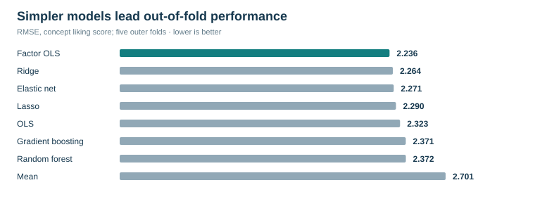
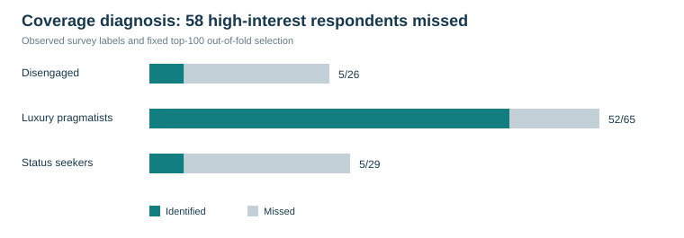
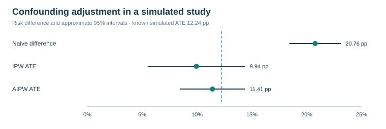
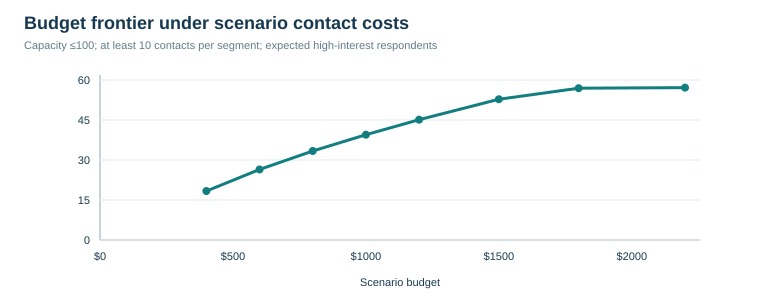

# Microvan Consumer Intelligence & Decision Optimization

**Business-facing Data Science Portfolio | Kangjie Lin**

A decision-oriented study of consumer preference, product-market validation, targeting efficiency and constrained allocation for a premium compact family vehicle. Start with the [formatted writing sample (PDF)](reports/Microvan_Writing_Sample.pdf), read the [web edition](reports/portfolio.md), or explore the [analysis notebook](notebooks/01_business_facing_analysis.ipynb).

**[Open the interactive Streamlit demo](https://microvan-consumer-intelligence-hdntmczefiubcdsqjdeyus.streamlit.app)** · [Writing sample (PDF)](reports/Microvan_Writing_Sample.pdf) · [Technical report (PDF)](reports/Microvan_Technical_Report.pdf)

The hosted demo provides an interactive research prototype for preference prediction, segmentation, scenario budget optimization, and monitoring. It is not a production system.

## Executive recommendation

Advance the microvan concept to a controlled product-validation pilot—not a vehicle launch. Prioritize consumers who value both premium attributes and compact utility, protect exploration of less-represented segments, and validate incremental demand and economics before committing development capital.

| Observed survey / offline model result | Quantitative finding |
| --- | --- |
| Original case sample | 400 respondents, 30 attitude items |
| Five-factor OLS | Out-of-fold RMSE 2.236 vs 2.701 mean baseline (17.2% lower) |
| Model parsimony | 30 attributes compressed into five latent dimensions |
| Targeting effectiveness | 62% precision at top 100 vs 30% prevalence; 2.07× lift |
| Root cause diagnosis | 45 of 58 missed high-interest respondents outside the core segment |
| Corrective policy | Minimum 10 per segment retained 62 hits at the same 100-contact capacity |
| Questionnaire efficiency | 10-item selection policy RMSE 2.272 vs 2.264 tuned 30-item Ridge; fixed questionnaire requires prospective validation |





## Technical scope

| Workstream | Methods |
| --- | --- |
| Statistical learning | OLS, stepwise AIC, factor analysis, nested cross-validation, Ridge, Lasso, Elastic Net, RF, gradient boosting, XGBoost, ordinal logistic regression |
| Customer intelligence | Ward clustering, K-means, GMM, bootstrap cluster stability, ANOVA, Tukey contrasts |
| Predictive decisions | Calibrated classification, conformal intervals, feature selection, linear SHAP contributions, cost-sensitive thresholds |
| Product analytics | KPI tree, targeting lift, error decomposition, coverage policy and monitoring |
| Experimentation (simulation) | Random assignment, SRM, power, Holm adjustment, CUPED |
| Causal ML (simulation) | Cross-fitted IPW/AIPW, propensity matching, S/T/X-learners, honest transformed-outcome forest, Qini |
| Prescriptive analytics (scenario) | Mixed-integer optimization, budget frontier, maximin robustness, Monte Carlo stress |
| Business delivery | Pilot roadmap, acceptance criteria, local application and monitoring review gates |





## Get started

Use Python 3.13 (the research runtime) and a clean virtual environment.

```bash
git clone https://github.com/Gary666e/microvan-consumer-intelligence.git
cd microvan-consumer-intelligence
python -m venv .venv
source .venv/bin/activate
python -m pip install -r requirements.txt
python src/quickstart.py
python -m unittest discover -s tests
```

To run the complete research scripts in dependency order (these regenerate the detailed CSVs, separate simulation records, figures and fitted model artifact):

```bash
python run_analysis.py
```

### Interactive decision application

[Launch the hosted Streamlit demo](https://microvan-consumer-intelligence-hdntmczefiubcdsqjdeyus.streamlit.app).

The repository includes the fitted model and scenario data. After installing the research dependencies (or rebuilding the models with `python run_analysis.py`), start the original local prototype. Load serialized models only from trusted sources:

```bash
python microvan_v4/app.py
```

Open **http://127.0.0.1:8765**. It supports preference scoring, segment assignment, scenario budget optimization and input diagnostics. The alternative Streamlit interface and notebook can be started with:

```bash
python -m pip install -r requirements-app.txt
streamlit run app/dashboard.py
jupyter lab
```

The Streamlit dashboard is optional and uses a quick-start model; the original local application's scoring and optimization interfaces were smoke-tested. The hosted dashboard is a research demonstration, not a production deployment; local interface smoke tests do not establish cloud runtime validation.

## Repository guide

- [data/](data/) — unchanged original case survey and data dictionary.
- [notebooks/](notebooks/) — interactive quick-start notebook.
- [src/](src/) — compact analysis and monitoring examples.
- [microvan_v3/](microvan_v3/) — full statistical modeling, clustering and inference script.
- [microvan_v4/](microvan_v4/) — full supervised learning, survey selection, uncertainty, budget optimization and application code.
- [microvan_v5/](microvan_v5/) — experimentation, causal inference, uplift, robust allocation and monitoring code.
- [results/](results/) — archived quantitative outputs and diagnostic tables.
- [visualizations/](visualizations/) — web-readable charts.
- [reports/](reports/) — web portfolio and detailed research/execution report text.
- [tests/](tests/) — data, optimization and monitoring smoke tests.

## Evidence and limitations

The empirical dataset is the 400-respondent sample supplied with *Grosse Pointe Associates and the “Microvan”* (Modern Marketing Research: Concepts, Methods, and Cases). Simulated interventions, response records and scenario costs are separately identified; they demonstrate analytical methodology, not real causal effects, sales, marketing ROI or commercial deployment. Concept liking is not purchase probability. Cluster coverage is an offline exploratory policy and requires independent validation. The code uses fixed seeds; exact outputs may vary with library versions. Third-party case materials are not relicensed by this repository. 

## Reports and supporting exhibits

- [Writing sample — cover + 8-page consulting report (PDF)](reports/Microvan_Writing_Sample.pdf)
- [Editable writing sample (Word)](reports/Microvan_Writing_Sample_Editable.docx)
- [Editable cover (Word)](reports/Data_Science_Cover_Editable.docx)
- [Full technical report (PDF)](reports/Microvan_Technical_Report.pdf)
- [High-resolution exhibit gallery](visualizations/)
- [Validation notes](reports/VALIDATION.md) and [simulation provenance](data/SIMULATION_PROVENANCE.md)

All formatted reports, archived research outputs, original statistical exhibits and fitted model files are included in this repository. The 44 supplementary files were verified byte-for-byte against their release inventory using Git blob hashes.
