# Microvan Consumer Preference Intelligence

> Archived research report. Original PNG exhibits are included in the release asset package; the web portfolio contains immediately viewable SVG charts.

Predictive modeling, statistical inference, segmentation and constrained decision optimization

Kangjie Lin | Applied Data Science | Technical writing sample

### Executive summary

Grosse Pointe Associates (GPA) identified a potential niche for a premium, compact family vehicle. This study evaluates which attitudes explain concept liking, how accurately liking can be predicted, whether preference-based segments are stable, and how to prioritize research contacts under hypothetical resource constraints. The response is stated appeal on a 1–9 scale, not actual purchase behavior.

| Decision question | Quantitative evidence | Implication |
| --- | --- | --- |
| Which model? | Factor OLS RMSE 2.236; ordinal 2.233 | Simple latent models outperform tree benchmarks |
| Which customers? | Top 25% captures 62/120; lift 2.07× | Prioritize high-interest research contacts |
| Which segments? | 3 groups; median bootstrap ARI .980 | Premium and practical segment leads |
| How many questions? | 10-item loading policy RMSE 2.272 | Test a shorter questionnaire |
| How certain? | 90% intervals: 91.4% mean coverage | Individual predictions remain imprecise |
| How allocate resources? | MILP: 52.8 expected high-interest, $1,500 scenario | Illustrative constrained allocation, not realized ROI |

The analysis favors interpretable models and focused concept testing. Commercial priorities are premium compact positioning, high-interest research recruitment, a shorter survey and cost-aware allocation. A local decision prototype supports these priorities; launch approval requires independent demand, price and unit-economics evidence (Section 15).

### Study scope and data sources

Sources: Grosse Pointe Associates and the “Microvan,” Modern Marketing Research: Concepts, Methods, and Cases, pp. 1–5; Team 8 academic report, pp. 1–15; microvan.csv (400 survey respondents). This writing sample integrates the team case with AI-assisted Python research extensions. Predictive and clustering models exclude identifiers and demographics. The resource-allocation study combines observed survey records with assumed outreach costs.

---

## 01 / Data quality and regression baseline

The dataset contains 400 screened respondents, 30 psychographic items, one liking outcome, seven demographic or behavioral variables and a unique identifier. The case sampled respondents from eligible panel households with some likelihood of buying a new car within a year; it is not a probability sample of all US consumers. Each attitude and liking item is measured on a 1–9 scale.

| Audit item | Result |
| --- | --- |
| Rows / columns | 400 / 39 |
| Missing cells / duplicate IDs / duplicate non-ID rows | 0 / 0 / 0 |
| Out-of-range attitude and outcome values | 0 |
| Mean liking / standard deviation | 4.843 / 2.690 |
| Cook’s distance > 4/n / maximum | 22 / 0.0339 |

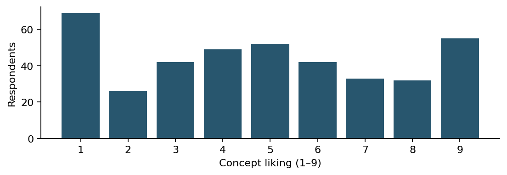

### Regression baseline and feature selection

The full ordinary least squares (OLS) model achieves R² = 0.3729, adjusted R² = 0.3219 and F(30,369) = 7.314. Leather preference (β = 0.248, p = .043) and carpool attitudes (β = −0.287, p = .020) are nominally significant; neither survives Bonferroni correction across 30 slopes. Median VIF is 2.64 (maximum 5.08), indicating some redundancy, not uniformly severe multicollinearity. Breusch–Pagan p = .953 provides no evidence of heteroskedasticity under that test.

Backward AIC selection retains 11 attributes (adjusted R² 0.3395; AIC 1772.7 vs. 1801.1). This is an exploratory, in-sample comparison; its post-selection coefficients are not confirmatory, and this selected model was not included in the nested predictive benchmark.

---

## 02 / Latent preference extraction

A correlation-based PCA diagnostic yields five eigenvalues above one (8.28, 5.00, 3.09, 2.71, 1.80); the sixth is 0.63. Parallel analysis using 200 independent Gaussian reference matrices and the 95th-percentile eigenvalue also supports five dimensions. KMO = 0.923 and Bartlett χ²(435) = 7,884.1 support factorability.

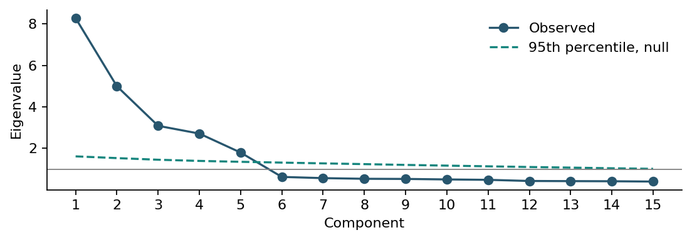

Maximum-likelihood factor analysis with orthogonal Varimax rotation explains 64.0% of total standardized item variance (sum of squared loadings / 30). Factor signs and ordering are anchored to the corresponding item wording. Representative signed loadings:

| Dimension | Representative item loadings |
| --- | --- |
| Luxury | buyhghnd +0.79, carefmny -0.76, pricqual +0.72 |
| Practicality | miniboxy +0.83, suvcmpct +0.80, noparkrm +0.78 |
| Family | kidtrans +0.95, nordtrps -0.82, kidsbulk +0.77 |
| Safety | safeimpt +0.89, perfimpt -0.84, lk4whldr +0.81 |
| Environment | envrminr -0.83, shdcarpl +0.82, wntguzlr -0.69 |

The Safety factor contrasts safety/warranty/4WD preference with performance priority; it is not a simple index of both safety and performance. Environmental orientation is separately anchored by carpool attitudes and lower tolerance for environmental impact. This item-level mapping matters when interpreting coefficients.

---

## 03 / Regression interpretation and model selection

Replacing 30 items with five factor scores gives R² = 0.3365 and adjusted R² = 0.3281. This retains 90.3% of baseline in-sample R², but the more meaningful test is generalization to held-out observations. Coefficients are associations on estimated factor-score scales and are not causal effects.

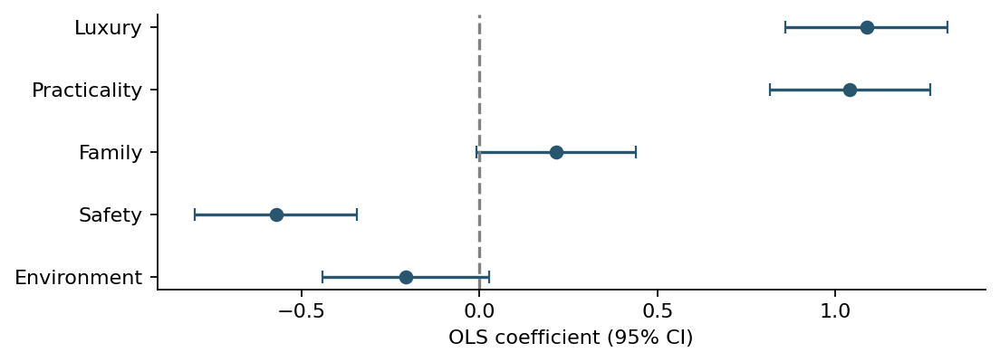

| Factor | Coefficient | p-value | 95% CI |
| --- | --- | --- | --- |
| Luxury | +1.088 | 5.95e-19 | [+0.859, +1.316] |
| Practicality | +1.041 | 5.4e-18 | [+0.815, +1.266] |
| Family | +0.215 | 0.0588 | [-0.008, +0.439] |
| Safety | -0.572 | 1.16e-06 | [-0.800, -0.344] |
| Environment | -0.208 | 0.0815 | [-0.442, +0.026] |

Luxury and practicality are strongly positive. Safety versus performance is negative; family and environmental orientation do not reach nominal 5% significance. The three strongest effects also survive Bonferroni correction across five factor slopes.

### Interpretation of factor structure

The item loadings associate the large negative coefficient with a safety/performance contrast, rather than environmental consciousness. This differs from the Team 8 report; the original R script is unavailable, and extraction, rotation or labeling differences cannot be ruled out. Environmental messaging merits testing rather than categorical exclusion.

---

## 04 / Out-of-sample model benchmarking

The initial eight candidate models use identical shuffled five-fold outer splits (seed 42), with four-fold inner tuning for hyperparameters. Standardization and factor extraction are fitted within each training split. The five-factor specification is motivated by exploratory factor analysis; no independent external test set exists. OOF metrics pool each respondent’s single outer-fold prediction. The target is treated as numeric; no predictions are clipped.

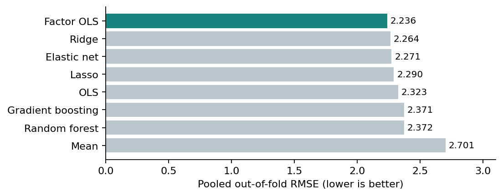

| Model | RMSE | MAE | OOF R² | Fold RMSE SD |
| --- | --- | --- | --- | --- |
| Factor OLS | 2.236 | 1.858 | 0.307 | 0.113 |
| Ridge | 2.264 | 1.885 | 0.290 | 0.100 |
| Elastic net | 2.271 | 1.900 | 0.285 | 0.090 |
| Lasso | 2.290 | 1.916 | 0.274 | 0.092 |
| OLS | 2.323 | 1.924 | 0.252 | 0.132 |
| Gradient boosting | 2.371 | 1.992 | 0.221 | 0.101 |
| Random forest | 2.372 | 1.979 | 0.221 | 0.122 |
| Mean | 2.701 | 2.296 | -0.011 | 0.174 |

Factor OLS lowers RMSE by 17.2% versus the mean baseline and 3.7% versus full OLS. Ridge is close (2.264), while tree ensembles do not outperform the linear models on these data. The small gap to Ridge is descriptive rather than proof of superiority. Select factor OLS as a parsimonious candidate and verify the comparison on an independent panel before deployment.

---

## 05 / Unsupervised segmentation and stability

Ward hierarchical clustering provides an exploratory comparison. K-means is then fit to the five factor scores for k = 2–6, using 30 initializations. Neither liking nor demographics enter clustering. Evaluate internal separation (silhouette and Davies–Bouldin), then bootstrap the complete factor-scoring and K-means pipeline 50 times, scoring agreement with the reference labels on all original observations using adjusted Rand index (ARI).

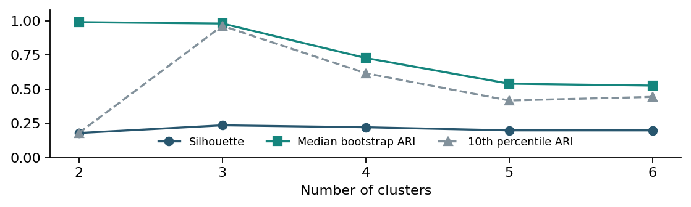

| k | Silhouette ↑ | DB ↓ | Median ARI ↑ | P10 ARI ↑ |
| --- | --- | --- | --- | --- |
| 2 | 0.179 | 2.018 | 0.990 | 0.180 |
| 3 | 0.235 | 1.559 | 0.980 | 0.963 |
| 4 | 0.221 | 1.541 | 0.728 | 0.616 |
| 5 | 0.198 | 1.522 | 0.540 | 0.417 |
| 6 | 0.198 | 1.558 | 0.526 | 0.443 |

Three clusters offer the highest silhouette (0.235) and strongest lower-tail stability (P10 ARI 0.963). Two clusters have a slightly higher median ARI but a much weaker lower tail; four and five have slightly better DB scores, but lower stability. Ward versus three-cluster K-means agreement is ARI 0.754. These metrics support the three-group solution, while the low absolute silhouette indicates substantial overlap. Bootstrap stability evaluates sensitivity to sampling within this panel, not external generalizability.

---

## 06 / Segment validation and targeting

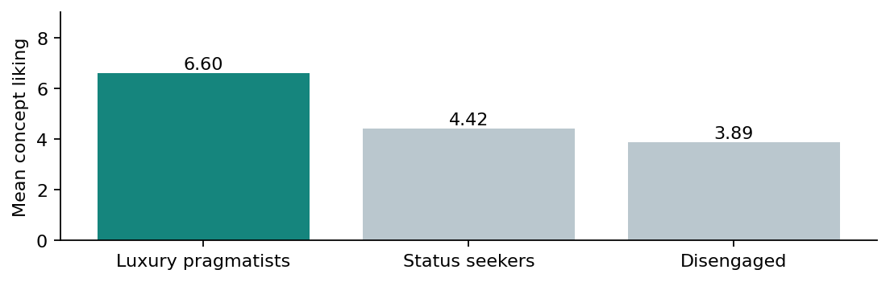

| Profile | Luxury pragmatists | Status seekers | Disengaged |
| --- | --- | --- | --- |
| Sample size / share | 116 / 29.0% | 126 / 31.5% | 158 / 39.5% |
| Mean liking | 6.60 | 4.42 | 3.89 |
| Mean age | 44.3 | 46.1 | 32.1 |
| Household income ($K) | 83.1 | 103.9 | 36.6 |
| Children | 1.95 | 1.21 | 0.69 |
| Household miles (K) | 22.2 | 18.4 | 14.7 |
| Luxury factor | +0.61 | +0.59 | -0.92 |
| Practicality factor | +1.11 | -1.07 | +0.04 |

ANOVA F(2,397) = 44.29, p < .001; η² = .182 and ω² = .178. Tukey-adjusted contrasts: pragmatists exceed status seekers by 2.18 points (95% CI 1.44–2.92) and disengaged by 2.72 (2.02–3.42), both p < .001. Other groups differ by 0.53 points (p = .159). Age, income, mileage, children and education differ at p < .001; gender and recycling do not (p = .193 and .745).

The segmentation yields 116, 126 and 158 respondents. These counts and the observed age range (19–60) clarify inconsistencies in the earlier Team 8 report. No demographic differences establish causality.

---

## 07 / High-interest prediction and targeting

Define a high-interest respondent as one with concept liking ≥7 (120/400, 30%). This threshold is an analyst-defined research rule, not observed purchase intent. Compare ranking with five dedicated classifiers (L1/L2 logistic, factor logistic, random forest and XGBoost). The outer five-fold splits match the regression benchmark; inner four-fold stratified tuning optimizes log loss. Sigmoid calibration fits on inner cross-validation predictions, never on the outer test outcomes.

| Model / score | ROC-AUC | Avg. precision | Brier ↓ | P@100 | Lift |
| --- | --- | --- | --- | --- | --- |
| Factor OLS (ranking) | 0.766 | 0.580 | — | 62% | 2.07× |
| Factor logistic | 0.753 | 0.547 | 0.175 | 59% | 1.97× |
| Logistic L2 | 0.746 | 0.549 | 0.177 | 55% | 1.83× |
| Logistic L1 | 0.721 | 0.515 | 0.183 | 57% | 1.90× |
| Random forest | 0.724 | 0.507 | 0.182 | 56% | 1.87× |
| XGBoost | 0.699 | 0.480 | 0.188 | 53% | 1.77× |

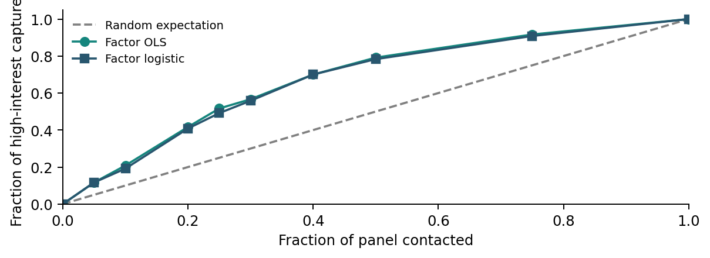

Factor OLS captures 62/120 high-interest respondents using 100 contacts (62% precision, 51.7% recall, 2.07× lift). The calibrated factor classifier captures 59/120 (59% precision, 49.2% recall, 1.97× lift). OLS is the better observed ranker; use factor logistic when an explicit probability is needed. The 30% constant random baseline has expected AUC .5, AP .30 and lift 1. A cross-fold training-prevalence predictor has artificial ranking variation, so its pooled ranking statistics are not used as the random reference.

---

## 08 / Calibration and ordinal sensitivity

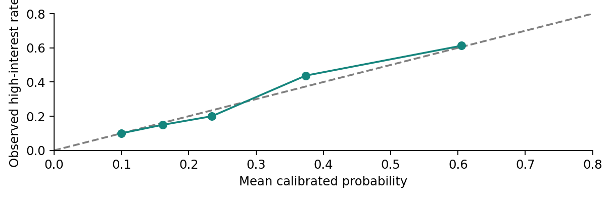

| Quintile | Mean p | Observed rate |
| --- | --- | --- |
| 1 | 0.100 | 0.100 |
| 2 | 0.162 | 0.150 |
| 3 | 0.234 | 0.200 |
| 4 | 0.374 | 0.438 |
| 5 | 0.605 | 0.613 |

Calibration is not automatically beneficial: factor-logistic Brier loss changes from .1743 (raw) to .1747 (sigmoid-calibrated). The calibrated variant is retained as an operational probability candidate for the resource-allocation scenario, not because it is proven superior. All five ordinal proportional-odds models converge. Their expected score (sum of class probabilities times levels 1–9) yields RMSE 2.233 vs. factor OLS 2.236, and ordinal high-interest AUC 0.762. XGBoost regression RMSE is 2.372. The ordinal model respects the outcome scale but its proportional-odds assumption has not been independently validated.

| Interest cutoff | Positive n | OLS AUC | P@100 | Lift |
| --- | --- | --- | --- | --- |
| ≥6 | 162 | 0.769 | 76% | 1.88× |
| ≥7 | 120 | 0.766 | 62% | 2.07× |
| ≥8 | 87 | 0.813 | 53% | 2.44× |

The interest threshold changes prevalence and the trade-off between coverage and precision. Choose it prospectively using the next research objective; do not optimize the cutoff against this same panel.

---

## 09 / Robustness and uncertainty

Repeat the nested benchmark for factor OLS, Ridge and full OLS using three shuffled outer seeds (42, 2026, 31415), five outer folds and four inner folds for Ridge. The five-factor specification is held fixed. All performance estimates use held-out observations; repeat-level metrics are not independent replications.

| Model | Seed 42 | Seed 2026 | Seed 31415 | Mean RMSE |
| --- | --- | --- | --- | --- |
| Factor OLS | 2.236 | 2.233 | 2.232 | 2.234 |
| Ridge | 2.264 | 2.271 | 2.265 | 2.267 |
| OLS | 2.323 | 2.339 | 2.336 | 2.333 |

| RMSE difference vs. factor OLS | Mean | Conditional 95% interval |
| --- | --- | --- |
| OLS | 0.099 | [0.045, 0.150] |
| Ridge | 0.033 | [0.001, 0.065] |

The paired intervals resample respondents and their repeated cross-fitted squared errors 1,000 times. They condition on fitted predictions and omit retraining variance; they are descriptive, not a definitive test of model superiority.

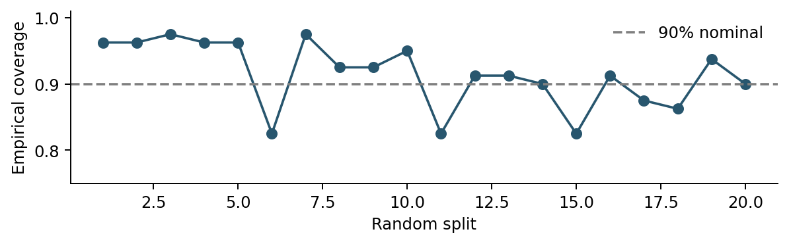

Split conformal prediction uses 240 training, 80 calibration and 80 test observations. The 90% radius is the 73rd ordered absolute calibration residual; intersect the interval with [1,9]. Mean test coverage is 91.4% (range 82.5%–97.5%); mean width is 6.40 points. Wide intervals demonstrate substantial individual uncertainty. Marginal coverage requires exchangeable future observations, not per-person certainty.

---

## 10 / Reducing data collection cost

Compare 5, 10, 15, 20 and 30 questionnaire items. Four selection policies operate only on outer training data: univariate F-test and Lasso coefficient ranking (Ridge alpha tuned inside the fold), factor-loading round robin and greedy forward selection (fixed Ridge alpha 10). Forward selection minimizes four-fold training CV error. Reduced models consume only selected original items, unlike five-factor scoring which still needs all 30.

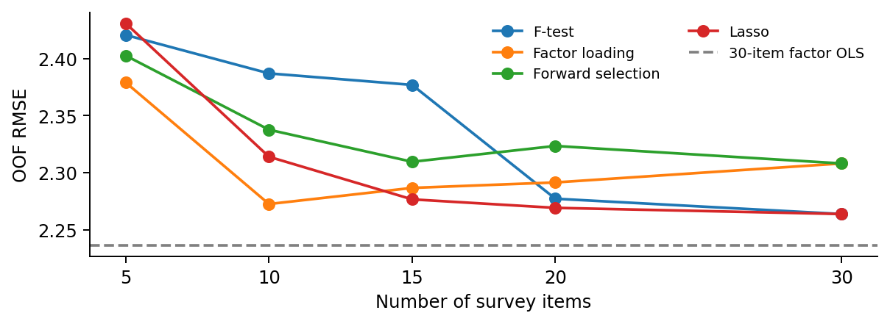

| Items | F-test | Lasso | Loadings | Forward |
| --- | --- | --- | --- | --- |
| 5 | 2.421 | 2.431 | 2.379 | 2.403 |
| 10 | 2.387 | 2.314 | 2.272 | 2.338 |
| 15 | 2.377 | 2.277 | 2.287 | 2.310 |
| 20 | 2.277 | 2.269 | 2.291 | 2.323 |
| 30 | 2.264 | 2.264 | 2.308 | 2.308 |

The 10-item loading policy reaches RMSE 2.272, only 0.39% above the tuned 30-item Ridge benchmark (2.264); 15-item Lasso ranking reaches 2.277, 0.57% above it. Ten items represent a 66.7% reduction in item count, not a measured reduction in survey time or cost. The loading method uses fixed alpha and is compared descriptively with tuned Ridge; its own full-item fixed-alpha baseline is 2.308. Fold-selected questionnaires can differ: these are evaluations of selection policies, not validated fixed questionnaires. Freeze a 10–15 item candidate and test prospectively before replacing the original instrument.

---

## 11 / Model explainability and error analysis

The factor-regression pipeline is affine in original items: f(x) = b + Σ wⱼ(xⱼ − μⱼ), where μ is the outer training mean. These exact interventional linear SHAP contributions use the marginal background mean and sum to each held-out prediction; they do not estimate conditional SHAP under correlated features or causal effects. Separately, permutation importance measures increase in outer-fold MSE when an original item is shuffled (8 permutations per fold).

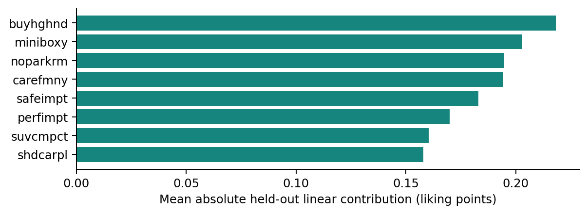

| Subgroup | n | RMSE | Mean error (pred − actual) |
| --- | --- | --- | --- |
| age / <=34 | 107 | 2.24 | +0.22 |
| age / 35–44 | 162 | 2.22 | +0.20 |
| age / 45+ | 131 | 2.26 | -0.48 |
| income / 50–99K | 149 | 2.32 | -0.16 |
| income / <50K | 157 | 2.22 | +0.07 |
| income / 100K+ | 94 | 2.12 | +0.06 |
| children / 1 | 148 | 2.29 | +0.07 |
| children / 2+ | 136 | 2.21 | -0.04 |
| children / 0 | 116 | 2.19 | -0.10 |
| gender / 0 | 184 | 2.27 | -0.36 |
| gender / 1 | 216 | 2.21 | +0.28 |

The ≥45 group is underpredicted by 0.48 points on average; the two recorded gender groups have opposite signed mean errors. Demographics are excluded from training but proxy effects remain possible. Subgroup results are exploratory, unadjusted for multiplicity and not evidence of fairness. Excluding 22 full-OLS Cook flags changes factor-model predictions by 0.16 points on average (correlation 0.997); retain all observations in the primary model. The higher reduced-sample in-sample R² is not a predictive gain.

---

## 12 / Soft segmentation and assignment confidence

Gaussian mixture models (GMM) provide an alternative to hard K-means labels, permitting component-specific covariance and posterior membership probabilities. Compare diagonal and full covariance across 2–6 components using Bayesian information criterion (BIC), silhouette and ARI versus the three-cluster K-means solution. Fit without liking or demographics.

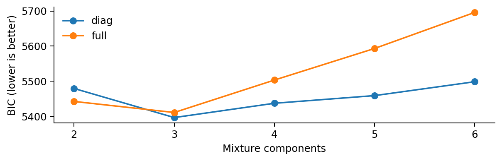

| Components | Diagonal BIC | Full BIC | Full silhouette |
| --- | --- | --- | --- |
| 2 | 5479.1 | 5442.1 | 0.178 |
| 3 | 5396.1 | 5410.6 | 0.235 |
| 4 | 5436.9 | 5503.1 | 0.191 |
| 5 | 5458.8 | 5593.2 | 0.181 |
| 6 | 5498.4 | 5696.1 | 0.185 |

Three-component diagonal GMM has the lowest BIC (5396.1); full covariance has ARI .993 versus K-means and 1.75% of observations with maximum posterior below .70. Its 50-resample median ARI is 0.959 (10th percentile 0.937). The model uses full covariance for the prototype’s illustrative soft scores; BIC favors diagonal covariance, so both remain alternatives. High model-based posterior probabilities do not eliminate the modest geometric silhouette or certify real-world segment certainty.

---

## 13 / Budget-constrained decision optimization

Optimize expected high-interest discovery, not incremental purchases. Let xᵢ ∈ {0,1} indicate outreach, pᵢ be the calibrated outer-fold probability, cᵢ the assumed per-contact cost, B budget, C capacity and m a minimum per attitude segment. Maximize Σ pᵢxᵢ subject to Σ cᵢxᵢ ≤ B, Σ xᵢ ≤ C and Σ xᵢ ≥ m within each segment. SciPy MILP / HiGHS solves the binary problem. The optimization uses observed survey responses and assumed contact costs.

Scenario assumptions: per-contact cost is a seeded uniform integer draw $8–$30 (seed 2026), independent of respondent features; budgets, capacities and segment minimums are analyst-defined. The comparison includes probability-ranked greedy, probability-per-dollar greedy and 100 random feasible greedy allocations. For a uniform cost and no additional constraints, ranking alone suffices.

| Budget / cap / min | Policy | Contacts | Cost | Expected high interest | Observed* |
| --- | --- | --- | --- | --- | --- |
| $800 / 60 / 0 | MILP | 60 | $800 | 33.6 | 35.0 |
| $800 / 60 / 0 | Probability rank | 42 | $800 | 28.5 | 24.0 |
| $800 / 60 / 0 | Probability/cost | 60 | $780 | 33.0 | 35.0 |
| $800 / 60 / 0 | Random feasible | 42.9 | $797 | 12.4 | 12.9 |
| $1,500 / 100 / 0 | MILP | 100 | $1,500 | 52.8 | 57.0 |
| $1,500 / 100 / 0 | Probability rank | 81 | $1,500 | 48.8 | 49.0 |
| $1,500 / 100 / 0 | Probability/cost | 100 | $1,483 | 52.4 | 57.0 |
| $1,500 / 100 / 0 | Random feasible | 80.0 | $1,498 | 23.3 | 24.1 |
| $1,500 / 100 / 10 | MILP | 100 | $1,500 | 52.8 | 57.0 |
| $1,500 / 100 / 10 | Probability rank | 78 | $1,496 | 46.4 | 45.0 |
| $1,500 / 100 / 10 | Probability/cost | 100 | $1,483 | 52.4 | 57.0 |
| $1,500 / 100 / 10 | Random feasible | 80.0 | $1,498 | 23.3 | 24.1 |
| $2,200 / 140 / 10 | MILP | 140 | $2,200 | 67.9 | 73.0 |
| $2,200 / 140 / 10 | Probability rank | 117 | $2,200 | 64.3 | 66.0 |
| $2,200 / 140 / 10 | Probability/cost | 139 | $2,194 | 67.8 | 74.0 |
| $2,200 / 140 / 10 | Random feasible | 116.9 | $2,197 | 34.3 | 35.4 |

*Observed = high-interest survey labels among selected respondents, not campaign conversions. Random policy columns are means. All four MILP solutions have zero reported optimality gap and satisfy the constraints. At a $1,500 assumed budget, capacity 100 and minimum 10 per segment, MILP selects 75 luxury pragmatists, 13 status seekers and 12 disengaged respondents (52.8 expected high-interest contacts; 57 observed in survey labels). Probability/cost greedy achieves 52.4 expected, making it a practical low-complexity baseline.

---

## 14 / Operational prototype and research decisions

The companion package implements a local five-view web application with saved training artifacts and a separately calibrated interval model. The standard-library HTTP app runs without a web framework; an optional Streamlit front end is supplied but was not executed because Streamlit is not installed in the analysis environment.

| View | Implemented functionality |
| --- | --- |
| Dashboard | Cross-fitted classification and repeated CV metrics |
| Predictor | 30 validated inputs; predicted liking, calibrated high-interest probability, nearest segment, distance margin, soft GMM probabilities and exact linear contributions |
| Segments | GMM BIC, silhouette and assignment uncertainty |
| Optimizer | User-defined scenario budget, capacity and segment minimum; MILP allocation or infeasibility message |
| Diagnostics | Subgroup errors, feature contributions, batch range checks and standardized mean drift |

The prototype’s full-panel regression/classifier is fitted for demonstration; evaluation uses separate cross-fitted predictions. Its 90% interval is centered on a different model trained on 240 observations with 80 held out for calibration. The app exposes both centers explicitly. Model artifacts are local and no outreach is sent. A smoke test verifies scoring, additive attribution, optimizer feasibility/infeasibility, batch validation and summary serialization.

### Research priorities

Prioritize premium, compact positioning with Luxury Pragmatists; use the targeting ranker to recruit follow-up research respondents, not to claim commercial conversion. Validate the shorter survey with a fixed prospective questionnaire. Run a randomized concept or conjoint test on price, size, luxury, safety, performance and environmental attributes. Collect actual purchase intent or behavior, and representative sampling weights before market sizing or revenue estimation.

### Limitations and release gates

The study uses one 400-person academic panel; model selection is exploratory. Independent external validation, observed outreach costs and campaign or sales outcomes are unavailable. The resource-allocation estimates are conditional on assumed costs. Production use requires a locked test panel, calibration and subgroup checks, data permissions, validated drift thresholds and a measured outreach experiment. The source materials, analysis scripts and experiment outputs accompany this report.

---

## 15 / Business implications and commercialization roadmap

Recommendation: advance the Microvan to targeted concept and pricing validation, not full-scale launch. The survey establishes a differentiated preference profile and a practical way to prioritize research resources; it does not establish unit demand, willingness to pay or investment returns.

### Product strategy | Design around premium compact utility

Luxury and practicality are the strongest positive preference dimensions (coefficients +1.088 and +1.041). Luxury Pragmatists represent 29% of the screened sample and average 6.60/9 in concept appeal, versus 4.42 and 3.89 in the other segments. Prioritize a compact footprint, premium cabin and family usability in prototype briefs. Test safety, acceleration, warranty and environmental messaging separately; the safety/performance contrast is not evidence that safety features reduce demand.

### Go-to-market | Prioritize research contacts, not entire demographics

The top 100 cross-fitted scores identify 62 of 120 high-interest respondents (62% precision; 2.07× lift; 51.7% recall). At the same contact count, random selection would identify 30 on average. This is evidence of more efficient concept-test recruitment within the panel. Keep a randomized comparison group and a broader exploration sample; avoid using income or age as stand-alone eligibility rules. Track response rate, qualified-interest yield and subsequent test-drive or purchase intent in a prospective pilot.

### Research economics | Reduce collection burden and allocate resources

The 10-item selection policy uses 66.7% fewer questions with RMSE 2.272 versus 2.264 for tuned 30-item Ridge. Pilot a fixed short instrument against the full survey and measure completion time, drop-off and held-out prediction error. Under the assumed $1,500 outreach scenario, MILP identifies 57 high-interest survey respondents versus 24.1 under random feasible allocation (2.37×); probability-per-dollar greedy also identifies 57. Start with the simpler policy unless budget, capacity or segment coverage constraints justify MILP. Neither measured survey savings nor campaign conversion is established.

### Investment gate | Turn preference evidence into commercial evidence

Run a representative, independent concept and price test; measure preference versus existing minivans and compact SUVs, willingness to pay, purchase intent and actual follow-through. Build a demand forecast from validated eligible-market counts, awareness, consideration and conversion rates. Compare contribution margin, cannibalization, development costs and scenario risk before an investment decision. The 29% segment share is a sample statistic, not a national market-size estimate. Use observed pilot outcomes to decide whether to scale, redesign or stop.

---

## Appendix A / Regression model outputs

The Team 8 R output (pp. 1–3) agrees with the Python OLS results to displayed precision. The table reports statsmodels estimates from the survey data. Standard errors and p-values are conventional OLS; robust HC3 p-values are available in the companion CSV.

| Term | Estimate | Std. error | t | p |
| --- | --- | --- | --- | --- |
| const | 0.3813 | 2.9586 | 0.129 | 0.8975 |
| kidtrans | 0.2411 | 0.1648 | 1.463 | 0.1443 |
| miniboxy | 0.1779 | 0.1293 | 1.376 | 0.1696 |
| lthrbetr | 0.2476 | 0.1220 | 2.030 | 0.0430 |
| secbiggr | -0.1048 | 0.1058 | -0.990 | 0.3227 |
| safeimpt | -0.0185 | 0.1336 | -0.139 | 0.8898 |
| buyhghnd | 0.1126 | 0.1162 | 0.969 | 0.3331 |
| pricqual | 0.1053 | 0.1048 | 1.005 | 0.3155 |
| prmsound | 0.0101 | 0.1083 | 0.093 | 0.9256 |
| perfimpt | 0.2327 | 0.1282 | 1.815 | 0.0704 |
| tkvacatn | 0.1662 | 0.1247 | 1.333 | 0.1834 |
| noparkrm | 0.1781 | 0.1158 | 1.538 | 0.1248 |
| homlrgst | -0.2087 | 0.1224 | -1.705 | 0.0891 |
| envrminr | -0.0332 | 0.1228 | -0.271 | 0.7867 |
| needbetw | 0.1285 | 0.1026 | 1.252 | 0.2115 |
| suvcmpct | 0.2151 | 0.1226 | 1.754 | 0.0802 |
| next2str | 0.0243 | 0.1068 | 0.227 | 0.8203 |
| carefmny | -0.2431 | 0.1344 | -1.809 | 0.0712 |
| shdcarpl | -0.2868 | 0.1224 | -2.343 | 0.0197 |
| imprtapp | 0.0591 | 0.1042 | 0.567 | 0.5711 |
| lk4whldr | -0.0641 | 0.1267 | -0.506 | 0.6132 |
| kidsbulk | -0.0970 | 0.1221 | -0.794 | 0.4275 |
| wntguzlr | -0.0289 | 0.1157 | -0.250 | 0.8026 |
| nordtrps | 0.0731 | 0.1275 | 0.573 | 0.5669 |
| stylclth | 0.0158 | 0.1136 | 0.139 | 0.8898 |
| strngwrn | -0.1968 | 0.1134 | -1.735 | 0.0836 |
| passnimp | 0.1620 | 0.1191 | 1.360 | 0.1745 |
| twoincom | 0.1704 | 0.0965 | 1.767 | 0.0781 |
| nohummer | 0.0091 | 0.0957 | 0.095 | 0.9247 |
| aftrschl | -0.0257 | 0.1166 | -0.221 | 0.8255 |
| accesfun | -0.0035 | 0.1221 | -0.028 | 0.9774 |

Full model: n = 400; R² = .3729; adjusted R² = .3219; residual df = 369; F = 7.314. Original R printed p < 2.2e−16; Python computes approximately 4.96e−23. Both indicate strong overall significance.

---

## Appendix B / Factor loadings and analysis settings

Complete rotated factor loadings (rounded). Positive signs are anchored to leather preference, minivan bulk, child transport, safety importance and carpool attitudes respectively.

| Item | Luxury | Practicality | Family | Safety | Environment |
| --- | --- | --- | --- | --- | --- |
| kidtrans | +0.12 | -0.00 | +0.95 | +0.01 | -0.03 |
| miniboxy | +0.11 | +0.83 | -0.09 | +0.02 | +0.06 |
| lthrbetr | +0.70 | -0.19 | +0.24 | +0.07 | +0.27 |
| secbiggr | -0.06 | +0.72 | +0.05 | -0.06 | +0.02 |
| safeimpt | +0.03 | +0.03 | +0.05 | +0.89 | -0.02 |
| buyhghnd | +0.79 | +0.17 | +0.03 | +0.10 | +0.05 |
| pricqual | +0.72 | -0.18 | -0.06 | +0.01 | -0.10 |
| prmsound | +0.66 | -0.02 | +0.16 | +0.08 | +0.27 |
| perfimpt | +0.10 | -0.07 | -0.07 | -0.84 | +0.02 |
| tkvacatn | +0.66 | -0.03 | +0.25 | +0.03 | +0.43 |
| noparkrm | +0.16 | +0.78 | +0.02 | -0.01 | -0.07 |
| homlrgst | +0.34 | -0.66 | +0.14 | +0.08 | +0.29 |
| envrminr | -0.20 | -0.04 | +0.07 | -0.01 | -0.83 |
| needbetw | +0.12 | +0.71 | +0.00 | +0.05 | +0.04 |
| suvcmpct | +0.08 | +0.80 | +0.20 | +0.01 | +0.04 |
| next2str | +0.24 | -0.71 | +0.09 | -0.01 | -0.10 |
| carefmny | -0.76 | -0.14 | -0.20 | -0.08 | -0.29 |
| shdcarpl | +0.20 | -0.03 | -0.05 | +0.07 | +0.82 |
| imprtapp | +0.51 | -0.02 | +0.31 | +0.19 | +0.31 |
| lk4whldr | +0.17 | +0.01 | +0.03 | +0.81 | +0.10 |
| kidsbulk | +0.19 | +0.01 | +0.77 | +0.04 | +0.05 |
| wntguzlr | -0.38 | +0.03 | -0.02 | +0.02 | -0.69 |
| nordtrps | -0.08 | -0.09 | -0.82 | -0.05 | -0.01 |
| stylclth | +0.60 | +0.22 | +0.18 | -0.02 | +0.39 |
| strngwrn | +0.27 | -0.26 | +0.09 | +0.67 | +0.06 |
| passnimp | -0.64 | -0.01 | -0.38 | +0.01 | -0.25 |
| twoincom | +0.68 | +0.12 | -0.06 | +0.09 | -0.03 |
| nohummer | +0.06 | +0.65 | +0.04 | +0.04 | -0.04 |
| aftrschl | +0.20 | -0.11 | +0.72 | +0.18 | -0.10 |
| accesfun | +0.68 | -0.04 | +0.29 | +0.01 | +0.34 |

Python model settings: sklearn FactorAnalysis (maximum likelihood, Varimax, LAPACK SVD); KMeans (30 starts, seed 42); outer 5-fold KFold (shuffle, seed 42), inner 4-fold (seed 100 + outer fold). Bootstrap seeds 1000–1049. Full hyperparameter grids and fold-level chosen values are preserved in the analysis package.

---

## Appendix C / Data diagnostics and experiment records

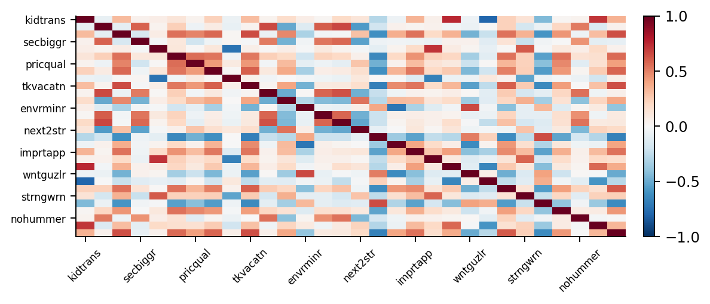

### Analysis files and execution

The project package contains the survey dataset, case brief, team report, analysis scripts, result CSVs, chart files, execution logs, saved models and local application. The analysis entry points are python microvan_v3/analyze.py, python microvan_v4/analysis_v4.py and python microvan_v4/survey_extra.py. Run python microvan_v4/app.py for the local prototype at http://127.0.0.1:8765. The optional Streamlit interface requires streamlit; dependency details are in README.

The technical records include Python model summaries, factor loadings, predictions, selected feature lists, tuning logs and scenario allocations. The Team 8 R outputs are retained as source evidence; the original R script is unavailable. Survey labels and training observations remain unchanged.
