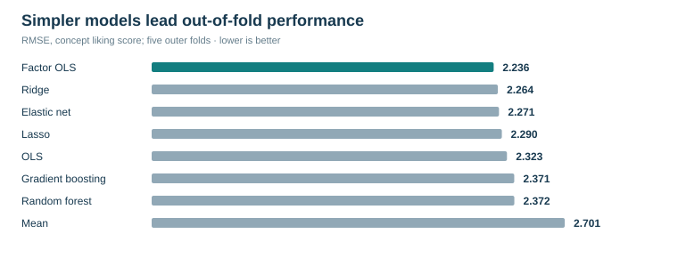
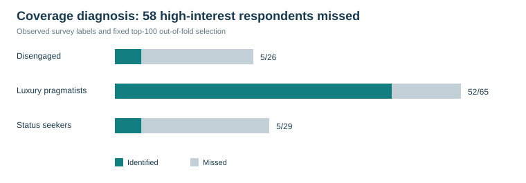
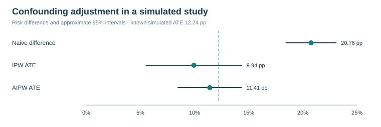
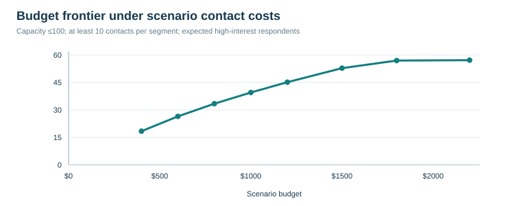
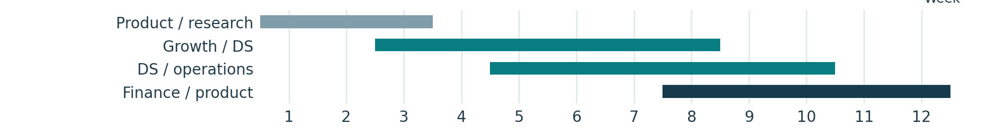

# Microvan Consumer Intelligence & Decision Optimization

**Writing sample for Data Scientist and related roles | Kangjie Lin**

Applied data science for product strategy, customer targeting and commercial decision-making. This web edition follows the eight-section consulting report. Survey findings below are offline estimates from the original 400-response case; experimental and causal results are simulations, and the cost scenarios are hypothetical.

## 1. Validate a premium compact niche before committing development capital

The case describes a lengthy vehicle-development cycle and model-line costs often exceeding $1B. The management question is whether evidence supports a targeted product-validation pilot. A premium, right-sized family vehicle is the proposition to test, luxury pragmatists are the priority audience, and prospective pricing/demand evidence is the next investment gate.

## 2. Select a model based on validation, not complexity

The five-factor regression produces pooled out-of-fold RMSE of 2.236, versus 2.323 for the original 30-variable OLS and 2.701 for a mean baseline. Nested validation fits preprocessing and model tuning inside training folds. Five factors improve parsimony but still require the original questionnaire. Prediction intervals and diagnostics constrain individual-level confidence.

## 3. Use segmentation and a shorter survey to focus research

Three descriptive clusters emerge: luxury pragmatists (116, 29.0%, mean liking 6.60), status seekers (126, 31.5%, 4.42), and disengaged (158, 39.5%, 3.89). The three-cluster solution has a silhouette of about 0.235 and high median bootstrap ARI; overlap remains substantial. A ten-item factor-loading selection policy has RMSE 2.272 versus 2.264 for tuned 30-item Ridge. Freeze and independently validate a short questionnaire before adoption.

## 4. Diagnose coverage gaps rather than optimizing precision alone

Top-100 regression ranking identifies 62 of 120 high-interest respondents (62% precision, 51.7% recall, 2.07× lift). Forty-five of 58 missed respondents are outside the primary segment. A minimum-ten-per-segment policy preserves 62 hits while increasing non-core selections from 16 to 20 in this offline dataset. Monitor both efficiency and coverage.

## 5. Design controlled tests before changing product strategy

Proposed field pilot: randomize concept messaging, specify liking as the primary outcome, predefine a practical minimum effect, sample size and guardrails, and decide launch/iterate/stop before looking at outcomes. Four separate 1,600-record simulations demonstrate intention-to-treat estimation, confidence intervals, sample-ratio checks and multiplicity adjustment. A simulated 6,000-record trial demonstrates CUPED (9.4% estimated variance reduction). These are method checks, not commercial evidence.

## 6. Optimize incremental effects, not just baseline propensity

A simulated observational study includes known treatment effects and selection bias. Naive ATE is 20.76 pp; IPW 9.94 pp; AIPW 11.41 pp versus stipulated 12.24 pp. In a separate simulated holdout, uplift-based allocation outperforms random allocation in expected incremental responses under scenario costs. Real intervention data and identification assumptions are required before deploying a causal policy.

## 7. Allocate scarce resources with explicit risk trade-offs

Under hypothetical per-contact costs, a $1,500 budget and capacity of 100, nominal optimization selects 100 people with expected interest count 52.78; 57 have high-interest survey labels. Maximin allocation trades nominal expected coverage (47.51) for modeled cost robustness. These are retrospective/scenario results, not actual responses or realized ROI.

## 8. Execute, evaluate, and monitor

Proposed 12-week roadmap: freeze metrics and designs, validate concept positioning and survey burden, evaluate targeting/coverage, stress-test budget policies, then review commercialization readiness. Track verified high-interest completions per dollar, response coverage, quality and opt-outs. In the resampled mix-shift test, precision rises from 62% to 70% while recall falls from 51.7% to 23.9%; score PSI reaches 0.257 and selection falls from 25% to 7.5%. Investigate drift and capacity before changing thresholds, then validate on new labeled data. No automatic rollout or claim of field validation.

### Proposed pilot execution and evaluation

All targets below are planning gates, not achieved field results. Confirm thresholds and sample sizes before collecting new observations.

| Workstream | Execution | Proposed evaluation gate |
|---|---|---|
| Product positioning | Randomize comparable concept boards; control price and information exposure | Mean liking improves by at least 0.5 points, with a 95% interval excluding zero; monitor safety perception and price acceptance |
| Customer targeting | Compare ranked and random outreach at equal capacity | At least 1.5× verified high-interest yield; absolute difference interval excludes zero; monitor segment reach and opt-outs |
| Survey efficiency | Freeze the 10-item instrument and validate prospectively | At least 25% shorter median completion time; completion-rate loss no greater than 3 pp; upper confidence bound on RMSE increase no greater than 0.10 |
| Resource allocation | Compare feasible random, probability-per-cost and MILP policies under matched budgets | Zero budget/capacity violations and at least 10% improvement in qualified responses per dollar versus random allocation; justify MILP relative to greedy ranking |
| Commercial feasibility | Validate demand, willingness to pay, behavioral follow-through and unit economics | Sponsor-approved NPV and downside-risk criteria; no launch decision based on liking alone |

**Weeks 1–2:** freeze model versions, randomization, metrics and guardrails. **Weeks 3–8:** collect independent observations and monitor eligible-to-contacted-to-responded-to-verified-interest funnel counts. **Weeks 9–12:** evaluate effects and uncertainty, validate actual economics, and decide whether to scale, redesign or stop. If a policy underperforms, diagnose delivery, response, segment coverage and score calibration separately; freeze any revision and retest on a fresh sample.

## Supporting analysis

[Formatted writing sample (PDF)](Microvan_Writing_Sample.pdf) · [Full technical report (PDF)](Microvan_Technical_Report.pdf) · [Results](../results/) · [Source scripts](../microvan_v3/) · [Notebook](../notebooks/01_business_facing_analysis.ipynb)
